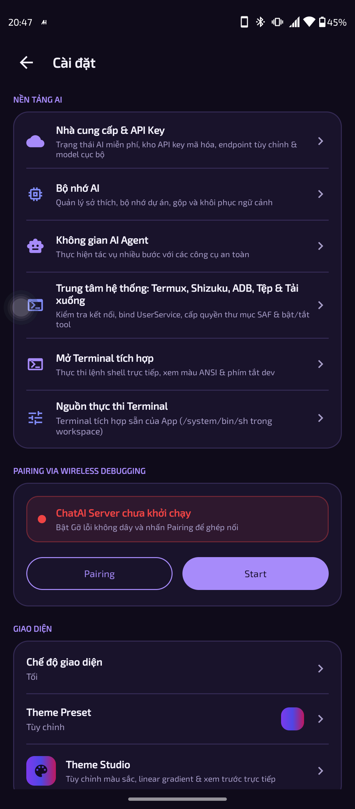
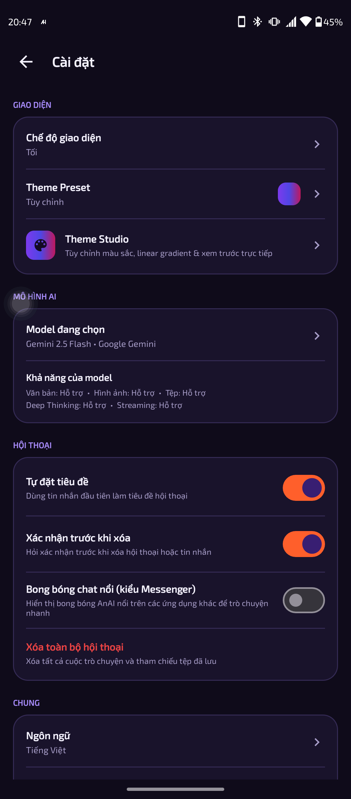
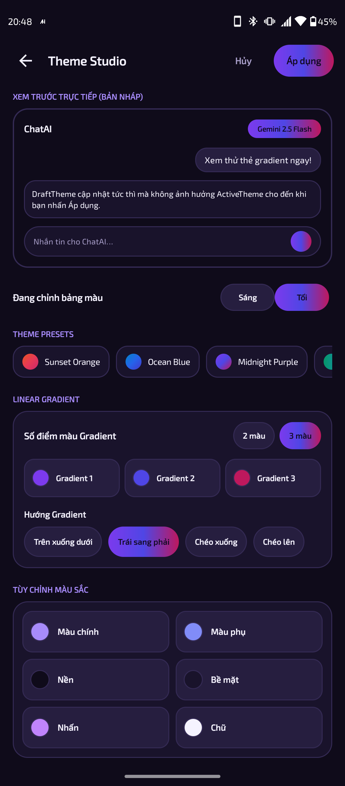
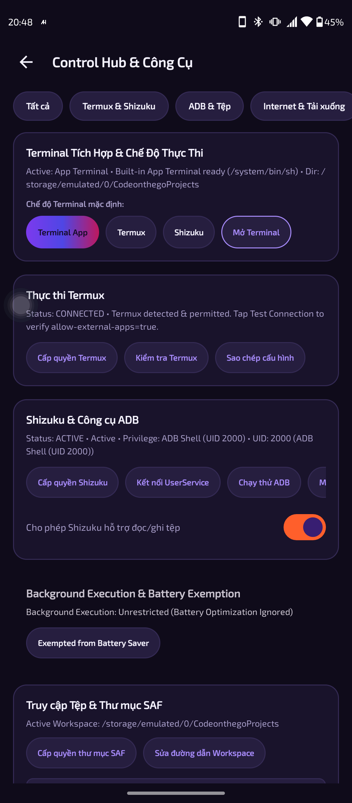
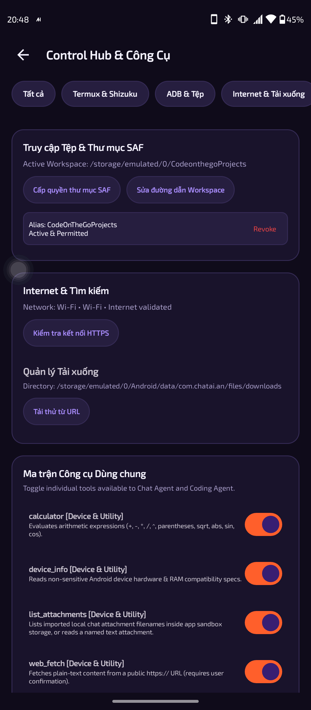

# ChatAI

Multi-Model AI Chat Application for Android, built with Java, XML, Material Design 3, Room, and Theme Studio.

A modular Android chat application that connects to multiple AI providers (Google Gemini, OpenRouter, Pollinations, Kilo, and local models), featuring Agent mode, tool execution, Wireless ADB debugging, Shizuku/Termux integration, floating chat bubble, and Theme Studio.

---

## 📱 Screenshots

<table>
  <tr>
    <td></td>
    <td></td>
    <td></td>
  </tr>
  <tr>
    <td></td>
    <td></td>
    <td></td>
  </tr>
  <tr>
    <td></td>
    <td></td>
    <td></td>
  </tr>
  <tr>
    <td></td>
    <td></td>
    <td></td>
  </tr>
</table>

---

## ✨ Features

- **Multi-Model AI Chat**: Google Gemini, OpenRouter (free), Pollinations (keyless), Kilo, and local models
- **Agent Mode**: Multi-step planning, tool execution, and user confirmation
- **Tool Platform**: File system, terminal, internet download, ADB integration
- **Wireless ADB**: Wireless debugging bridge (Shizuku alternative)
- **Termux**: Privileged shell access and background command execution
- **Floating Chat Bubble**: Messenger-style overlay for quick chat
- **Theme Studio**: Live color and gradient customization with presets
- **AI Memory**: Long-term memory, project-scoped memory, merge and restore
- **Multi-Language**: English, Vietnamese, French, Japanese, Korean, Chinese
- **Theme Presets**: Sunset Orange, Ocean Blue, Midnight Purple, Emerald, Rose Pink, Minimal Gray

---

## 🚧 Development Status (Unfinished Features)

The following features are incomplete in the current version:

- **Pair Wireless (Wireless ADB pairing)**: Not yet stable
- **Multi-Language**: Incomplete, not all languages supported yet
- **Termux API Integration**: Not yet functional
- Many other features are under development

---

## 🛠 Tech Stack

| Layer | Technology |
|-------|------------|
| Language | Java 11 |
| UI | XML + Material Design 3 + ViewBinding |
| Database | Room (SQLite) |
| Networking | OkHttp + Gson |
| Dependency Injection | Manual DI |
| Architecture | MVVM + Functional, one-way data flow |
| Background | AppExecutors |
| System Access | Wireless ADB, Termux RUN_COMMAND |

---

## 🚀 Getting Started

### Prerequisites

- Android Studio (latest stable)
- Android SDK API 36 (compileSdk), minSdk 26
- Java 11+

### Installation

1. Clone the repository:

```bash
git clone https://github.com/nguyenthanhan12062001/chatbot.git
cd chatbot
```

2. Open the project in Android Studio.
3. Create a `.env` file in the project root with your API keys:

```ini
# GOOGLE_GEMINI_API_KEY=your_google_gemini_key
# OPENROUTER_API_KEY=your_openrouter_key
```

4. Sync Gradle and run on an emulator or physical device.

### Release Build

The release APK is signed with a keystore kept locally in the project (`release-key.jks`).  
Configure your own signing in `app/build.gradle.kts` before building release:

```kotlin
signingConfigs {
    create("release") {
        storeFile = file("${rootDir}/release-key.jks")
        storePassword = System.getenv("STORE_PASSWORD") ?: "your_store_password"
        keyAlias = "release"
        keyPassword = System.getenv("KEY_PASSWORD") ?: "your_key_password"
    }
}
```

```bash
./gradlew assembleRelease
```

---

## 📂 Project Structure

```
chatbot/
├── app/
│   ├── src/main/java/com/chatai/an/
│   │   ├── ai/               # AI core, providers, tools, agent, memory
│   │   ├── core/             # App container, executors, logger
│   │   ├── integration/      # ADB, Shizuku, Termux, Wireless ADB
│   │   ├── presentation/     # Activities, fragments, adapters, ViewModels
│   │   └── theme/            # Theme Studio, palettes, presets
│   └── res/                  # Layouts, drawables, values (6 languages)
├── gradle/
├── Screenshot/               # App screenshots
├── release-key.jks           # Release signing keystore
├── build.gradle.kts
├── settings.gradle.kts
└── gradle.properties
```

---

## 🤝 Contributing

Pull requests are welcome. For major changes, please open an issue first to discuss what you would like to change.

---

## 📄 License

This project is licensed under the MIT License.

---

**Maintained by Nguyen Thanh An**
