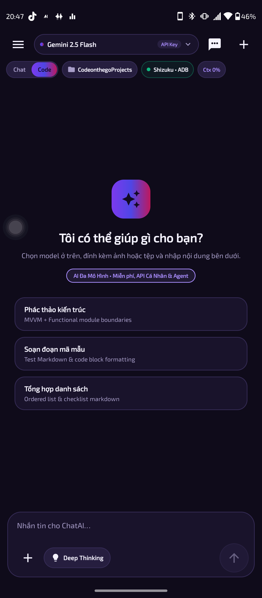
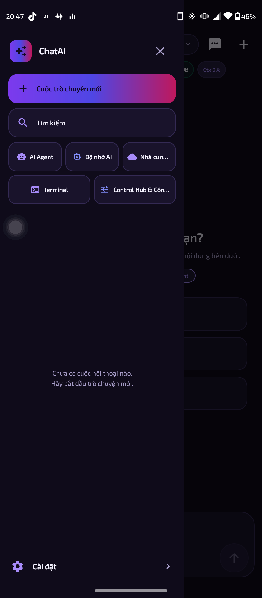
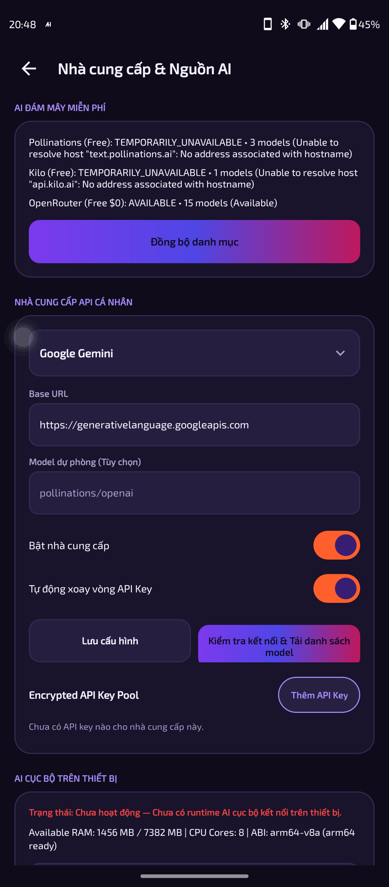
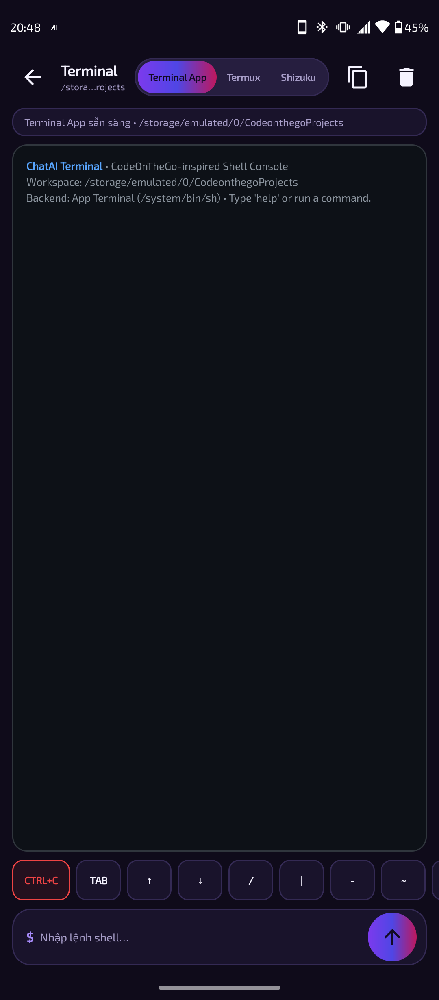
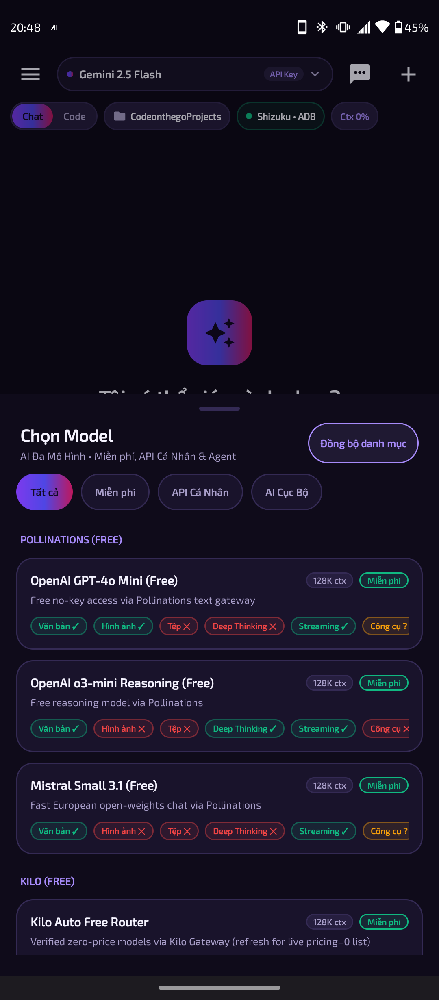
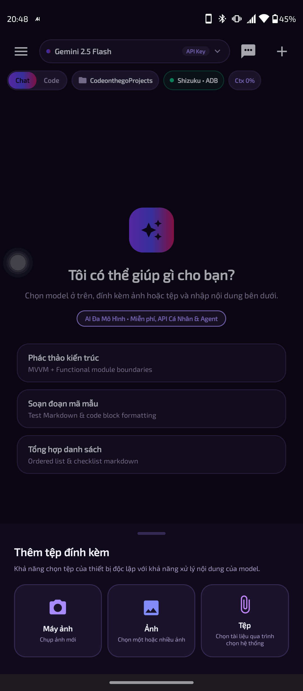

# ChatAI

Ung dung chat AI nhieu mo hinh cho Android, xay dung bang Java, XML, Material Design 3, Room va Theme Studio.

Ung dung chat Android modular ket noi voi nhieu nha cung cap AI (Google Gemini, OpenRouter, Pollinations, Kilo va model cu bo), co che do Agent, thuc thi tool, giam sat Wireless ADB, inte gration Shizuku/Termux, bong bao chat plao, va Theme Studio.

---

## 📱 Screenshots

<table>
  <tr>
    <td></td>
    <td></td>
    <td></td>
  </tr>
  <tr>
    <td></td>
    <td></td>
    <td></td>
  </tr>
  <tr>
    <td></td>
    <td></td>
    <td></td>
  </tr>
  <tr>
    <td></td>
    <td></td>
    <td></td>
  </tr>
</table>

---

## ✨ Tinh nang

- **Chat AI nhieu mo hinh**: Google Gemini, OpenRouter (mien phi), Pollinations (khong can key), Kilo va model cu bo
- **Che do Agent**: Ke hoach nhieu buoc, thuc thi tool va xac nhan nguoi dung
- **Nen tảng tool**: He thong tep, terminal, tai tai internet, inte gration ADB/Shizuku
- **Giam sat Wireless ADB**: ChatAI Server co san de giam sat tu xa
- **Shizuku & Termux**: Truy cap shell tien bien va thuc thi lenh nen nen
- **Bong bao chat plao**: Bong bao ngoai lai kieu Messenger de chat nhanh
- **Theme Studio**: Tu chinh mau sac va gradient thuc te voi cac bo mau
- **Bo nho AI**: Bo nho dai han, bo nho theo du an, gop va khoi phuc
- **Ngu ngon**: Tieng Anh, Tieng Viet, Tieng Phap, Tieng Nhat, Tieng Han, Tieng Trung
- **Bo mau Theme**: Sunset Orange, Ocean Blue, Midnight Purple, Emerald, Rose Pink, Minimal Gray

---

## 🚧 Tinh trang phat trien (Cac tinh nang chua hoan thien)

Doi day la cac tinh nang chua hoan thien trong phien ban hien tai:

- **Pair Wireless (Wireless ADB pairing)**: Chua hoat dong on dinh
- **Da ngu ngon**: Con thieu sot, chua day du tat ca cac ngu ngon
- **Tich hop API Termux**: Chua hoat dong
- Con nhieu tinh nang khac dang trong qua trinh phat trien

---

## 🛠 Tech Stack

| Tep | Cong nghe |
|-----|-----------|
| Ngon ngu lap trinh | Java 11 |
| Giao dien | XML + Material Design 3 + ViewBinding |
| Co so du lieu | Room (SQLite) |
| Mang | OkHttp + Gson |
| Tuong tu nhap | Manual DI |
| Kien truc | MVVM + Functional, luu lieu mot chieu |
| Nen nen | AppExecutors |
| Truy cap he thong | Shizuku API, Termux RUN_COMMAND |

---

## 🚀 Khoi dong nhanh

### Dieu kien can thiet

- Android Studio (ban moi nhat)
- Android SDK API 36 (compileSdk), minSdk 26
- Java 11+

### Cai dat

1. Clone kho luu tru:

```bash
git clone https://github.com/nguyenthanhan12062001/chatbot.git
cd chatbot
```

2. Mo du an trong Android Studio.
3. Tao tep `.env` trong goc du an voi cac khoa API cua ban:

```ini
# GOOGLE_GEMINI_API_KEY=ma_api_google_gemini_cua_ban
# OPENROUTER_API_KEY=ma_api_openrouter_cua_ban
```

4. Dong bo Gradle va chay trinh mo hoc hoac thiet bao chat thuc.

### Xay dung Release

APK Release duoc ky bang keystore luu o may local trong du an (`release-key.jks`).  
Cau hinh ky cua ban trong `app/build.gradle.kts` truoc khi xay dung release:

```kotlin
signingConfigs {
    create("release") {
        storeFile = file("${rootDir}/release-key.jks")
        storePassword = System.getenv("STORE_PASSWORD") ?: "mat_khau_keystore_cua_ban"
        keyAlias = "release"
        keyPassword = System.getenv("KEY_PASSWORD") ?: "mat_khau_key_cua_ban"
    }
}
```

```bash
./gradlew assembleRelease
```

---

## 📂 Cau truc du an

```
chatbot/
├── app/
│   ├── src/main/java/com/chatai/an/
│   │   ├── ai/               # Tim nhan AI, nha cung cap, tool, agent, bo nho
│   │   ├── core/             # Bo kho ung dung, bo thuc thuc, nhat ky
│   │   ├── integration/      # ADB, Shizuku, Termux, Wireless ADB
│   │   ├── presentation/     # Hoat dong, truong hop, bo dieu hoa
│   │   └── theme/            # Theme Studio, bo mau, bo mau coc
│   └── res/                  # Bo cuc, hinh anh, gia tri (6 ngu ngon)
├── gradle/
├── Screenshot/               # Anh chup man hinh ung dung
├── release-key.jks           # Keystore ky release
├── build.gradle.kts
├── settings.gradle.kts
└── gradle.properties
```

---

## � Dong dong gop

Pull requests duoc chao nghin. Cho cac thay doi lon, vui long mo issue truoc de thao luan thay doi ban muon.

---

## 📄 Giay phep

Du an duoc cap phep theo Giay phep MIT.

---

**Duoc duong tri boi Nguyen Thanh An**
